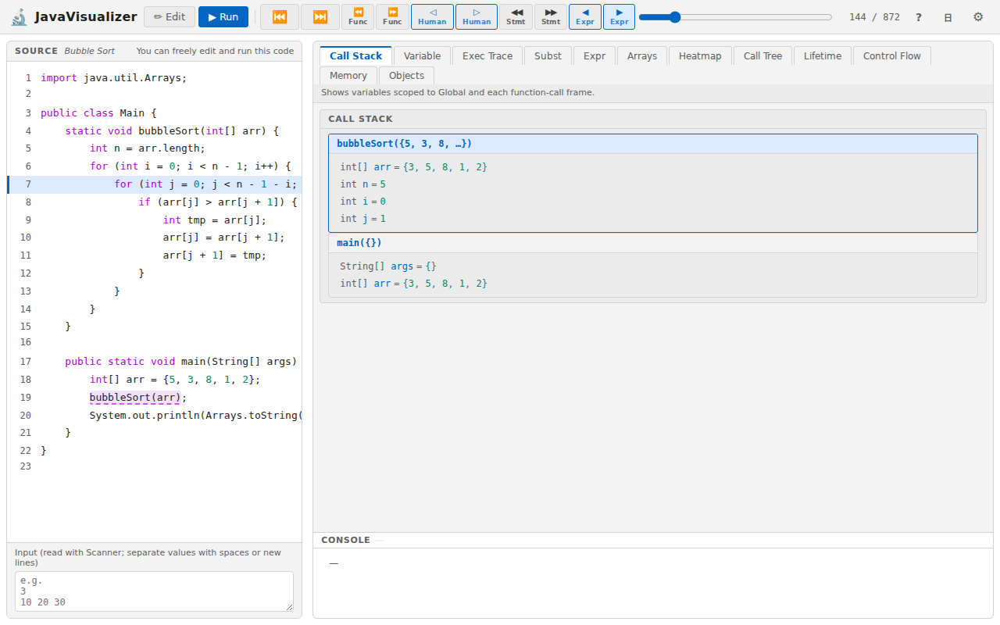

# JavaVisualizer

> 🚀 **[Live Demo](https://tntetsu.github.io/JavaVisualizer/)** — hosted on GitHub Pages

> [日本語の README](README.md)

> 📖 **[User manual](https://tntetsu.github.io/JavaVisualizer/manual.en.html)** — also available from the “?” button at the top right of the app

An educational web application that visualizes how a Java program runs, step by step.

It uses the same screen and the same **12 visualization views** as [JSVisualizer](https://github.com/tntetsu/JSVisualizer) (JavaScript) and [PyVisualizer](https://github.com/tntetsu/PyVisualizer) (Python), and lets you step through Java programs by expression, statement, and method call.



Just open it in a browser (no Java installation needed). All code runs inside your browser and is never sent to a server.

---

## Features

### An interpreter written for Java

Programs run on a Java interpreter built into JavaVisualizer (written in JavaScript); Java is not translated into JavaScript. `int` overflow (`Integer.MAX_VALUE + 1`), integer division (`7 / 2` is `3`), `char` arithmetic, `==` versus `equals` (including shared string literals), overloading, inheritance and overriding, and exceptions all behave as in real Java.

Correctness is checked by running the same programs on real Java (OpenJDK 21) and comparing the results (see [Tests](#tests)).

### Compile errors before running

As in real Java, the whole program is checked before it runs, catching mistakes common in introductory courses (mismatched types, undeclared variables, variables used before they have a value, a missing `return`, unreachable statements, checked exceptions, assigning to `final`, a missing `import`, etc.). Japanese messages explain the mistake for beginners; English messages are the same as `javac`.

### Java-specific display

- Variables are shown with their types, such as `int x = 3`
- The Memory view places arrays, objects and `String`s on the heap with arrows for references (two strings for which `s1 == s2` is `true` point to the same box)
- `static` fields appear under “static”
- A `NullPointerException` names what was `null` (`Cannot read field "value" because "n.next" is null`)
- Values read by `Scanner` are written in the input box below the source

### Stepping and views

Stepping (four granularities — Expr, Human, Stmt, Func — forward and backward) and the 12 views are shared with JSVisualizer. See the [manual](https://tntetsu.github.io/JavaVisualizer/manual.en.html) for details.

## Supported Java

`int`, `long`, `double`, `char`, `boolean`, `String`, arrays (one- and two-dimensional); `if`, `while`, `do`/`while`, `for`, enhanced `for`, `switch` (including `switch` expressions); methods (`static`, instance, recursion, overloading); classes (fields, constructors, inheritance, `super`, abstract classes, interfaces, `enum`); exceptions (`try`/`catch`/`finally`, `throw`, your own exceptions); `System.out.println`, `printf`, the main `String` methods, `Math`, `Integer.parseInt`, `Arrays`, `Scanner`; `ArrayList`, `HashMap`, `HashSet` (and `TreeMap`, `LinkedHashMap`, etc., with the same `HashMap` iteration order as real Java), `StringBuilder`, wrapper types and generic types; lambda expressions and method references (`forEach`, `sort`, `merge`, `Comparator`, `java.util.function`); streams (`filter`, `map`, `collect`, `Collectors`, `IntStream`; elements flow one at a time as in real Java) and `Optional`.

Not yet supported: `float`, `record`, some stream operations (`flatMap`, `parallelStream`), writing your own generic classes, non-`static` inner classes, file I/O.

## Running locally

The shared core (the `feature/interp-core` branch of JSInterpreter) and the frontend (the `feature/multilang` branch of JSVisualizer) must be checked out as sibling directories.

```bash
git -C ../JSInterpreter worktree add ../JSInterpreter-core feature/interp-core
git -C ../JSVisualizer worktree add ../JSVisualizer-multilang feature/multilang
npm install
node scripts/build.mjs --serve   # http://127.0.0.1:8124/
```

## Tests

```bash
npm test   # requires Node 22+ and Java (JDK 21); about one minute
```

| Test | What it checks |
|---|---|
| `tests/oracle.test.js` | Output, exceptions, and compile errors (line and `javac` message) against real Java (`java Main.java`) |
| `tests/line-state.test.js` | The sequence of variable-state changes, stepping real Java with JDI (`tests/tools/TraceStates.java`) |
| `tests/format.test.js` | `Double.toString` and `printf` formatting on about 10,000 values |
| `tests/npe.test.js` | Detailed `NullPointerException` messages against real Java compiled with `-g` |
| `tests/messages-en.test.js` | No Japanese left in English error messages |
| `tests/adr-examples.test.js` | User-visible examples from the design decisions (ADRs) |

## License

[MIT](LICENSE)
