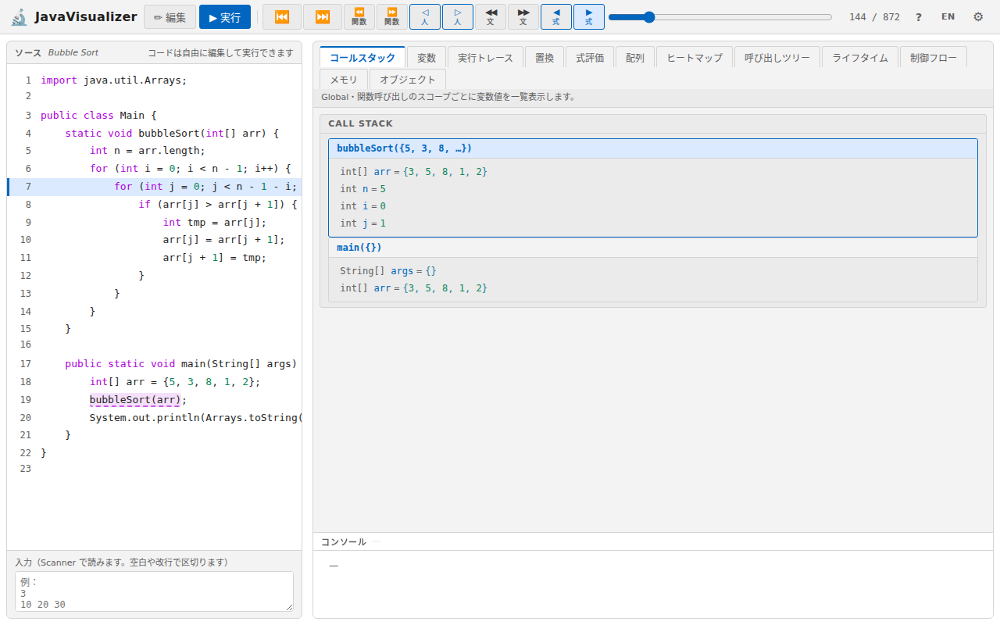

# JavaVisualizer

> [English README](README.en.md)

> 📖 **[使い方（利用者向けマニュアル）](manual/manual.html)** — 画面右上の「?」ボタンからも開けます

Java プログラムの実行過程をステップごとに可視化する、プログラミング教育用の Web アプリケーションです（開発中・公開前）。

JavaScript 版の [JSVisualizer](https://github.com/tntetsu/JSVisualizer)・Python 版の [PyVisualizer](https://github.com/tntetsu/PyVisualizer) と同じ画面・同じ **12 種類の可視化ビュー**で、Java のプログラムを式・文・メソッドの呼び出しの各粒度でステップ実行できます。



ブラウザで開くだけで使えます（Java のインストールは要りません）。コードはすべてブラウザの中で実行され、サーバーには送られません。

---

## 特徴

### Java 用に書いたインタプリタ

Java のプログラムは、JavaVisualizer に組み込んだ Java のインタプリタ（JavaScript で書いたもの）で動かします。JavaScript に変換して動かす方式は採っていません。`int` のあふれ（`Integer.MAX_VALUE + 1`）、整数の割り算（`7 / 2` は `3`）、`char` の計算、`==` と `equals` の違い（文字列のリテラルの共有を含む）、オーバーロード、継承とオーバーライド、例外まで、本物の Java のとおりに動きます。

正しさは、同じプログラムを本物の Java（OpenJDK 21）でも実行して比べるテストで確かめています（[テスト](#テスト)）。

### 実行前のコンパイルエラー

本物の Java と同じく、実行する前にプログラム全体を調べて、入門でよく出会う誤りを見つけます（型の合わない代入、宣言していない変数、値を入れる前に使う変数、`return` の忘れ、到達できない文、検査例外、`final` への再代入、`import` の忘れなど）。日本語では初学者向けの説明を、英語では `javac` と同じ文面を表示します。

### Java のための見せ方

- 変数を `int x = 3` のように型と一緒に表示します
- メモリのビューでは、配列・オブジェクト・`String` をヒープに置き、矢印で参照を示します（`s1 == s2` が `true` になる 2 つの文字列は同じ箱を指します）
- `static` フィールドは「static」の下に表示します
- `NullPointerException` は、何が `null` だったかを書きます（`Cannot read field "value" because "n.next" is null`）
- `Scanner` で読む値は、ソースの下の入力欄に書いておきます

### ステップ実行と可視化ビュー

ステップ実行（式・人・文・関数の 4 粒度 × 前後）と 12 種類のビュー（変数・実行トレース・コールスタック・ライフタイム・メモリ・式評価・置換・制御フロー・ヒートマップ・呼び出しツリー・配列・オブジェクト）は JSVisualizer と共通です。詳しくは[マニュアル](manual/manual.html)を見てください。

## 使える Java の範囲

`int`・`long`・`double`・`char`・`boolean`・`String`・配列（1 次元・2 次元）、`if`・`while`・`do`／`while`・`for`・拡張 `for`・`switch`、メソッド（`static`・インスタンス・再帰・オーバーロード）、クラス（フィールド・コンストラクタ・継承・`super`）、例外（`try`／`catch`／`finally`・`throw`・自作の例外）、`System.out.println`・`printf`・`String` の主なメソッド・`Math`・`Integer.parseInt`・`Arrays`・`Scanner`。

まだ使えないもの：`float`、インターフェース、`enum`、`record`、ラムダ式、ジェネリクス、`ArrayList`・`HashMap`、内部クラス、`switch` 式、ファイルの読み書き（[開発計画書](docs/development-plan.md) の Phase 5）。

## 動かし方

兄弟ディレクトリに、共通コア（JSInterpreter の作業ブランチ `feature/interp-core`）と画面（JSVisualizer の作業ブランチ `feature/multilang`）が必要です。

```bash
git -C ../JSInterpreter worktree add ../JSInterpreter-core feature/interp-core
git -C ../JSVisualizer worktree add ../JSVisualizer-multilang feature/multilang
npm install
node scripts/build.mjs --serve   # http://127.0.0.1:8124/
```

## テスト

```bash
npm test   # Node 22 以降と Java（JDK 21）が必要。約 1 分
```

| テスト | 内容 |
|---|---|
| `tests/oracle.test.js` | 本物の Java（`java Main.java`）と、出力・例外・コンパイルエラーの行と `javac` の文面を比べる |
| `tests/line-state.test.js` | 本物の Java を JDI でステップ実行し（`tests/tools/TraceStates.java`）、変数の状態の変化の列を比べる |
| `tests/format.test.js` | `Double.toString`・`printf` の書式を約 1 万通りの値で比べる |
| `tests/npe.test.js` | `NullPointerException` の詳しいメッセージを、`-g` 付きでコンパイルした本物と比べる |
| `tests/messages-en.test.js` | エラーメッセージの英語表示に日本語が残らないこと |
| `tests/adr-examples.test.js` | 設計の決定（ADR）の、利用者に見える例 |

## ドキュメント

- [開発計画書](docs/development-plan.md)（フェーズの状況）、各フェーズの報告書（`docs/phase0-report.md`〜）
- 設計の決定：[docs/adr/](docs/adr/)

## ライセンス

[MIT](LICENSE)
